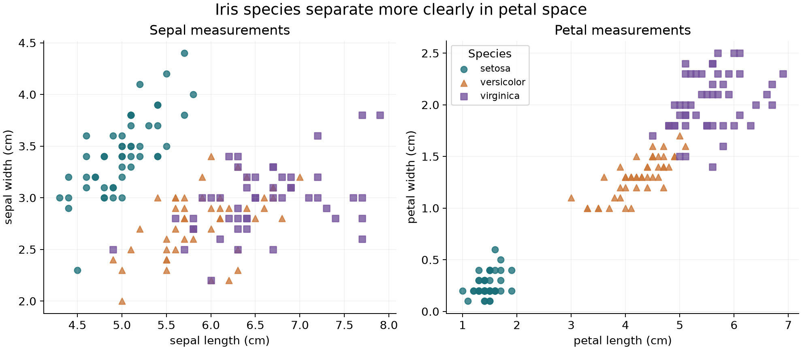
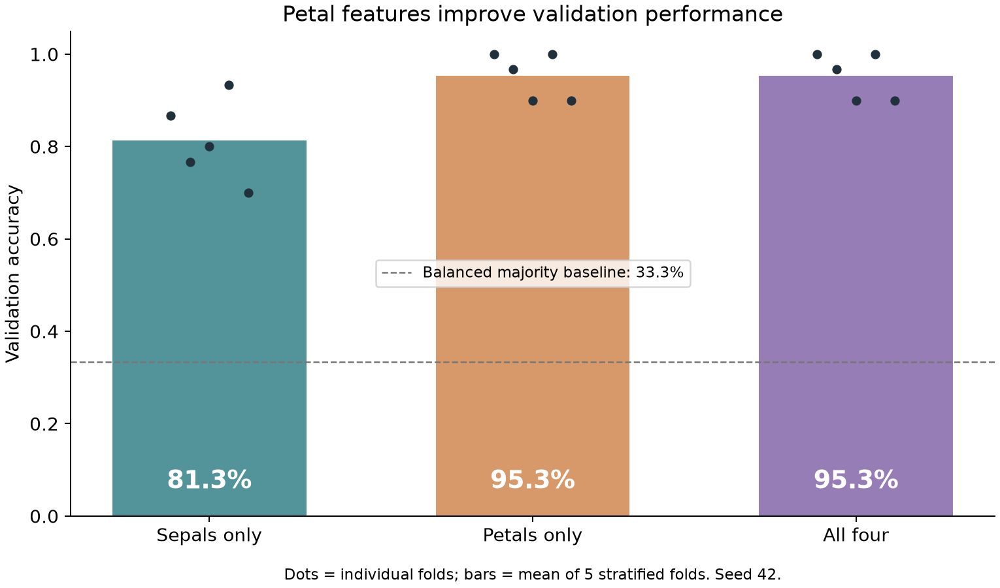

# CHEN YIMING
### Data analysis through reproducible evidence

I am studying data science and data visualization through CISC7204. This
portfolio presents a small analysis from question to reproducible results,
with attention to readable figures and the limits of the evidence.

**Skills demonstrated:** Python · pandas · NumPy · matplotlib · scikit-learn ·
data validation · classification · cross-validation · technical documentation

## Featured project
### Which Iris measurements help distinguish species?

**Question:** Do petal measurements classify Iris species better than sepal
measurements using the same logistic regression workflow?

**Status:** completed exploratory benchmark. Independent validation is planned.

Petal measurements separate the species more clearly in this sample. All
measurements are in centimetres; colours and point shapes identify species.

**Main finding:** sepals only: 81.3%; petals only: 95.3%; all four: 95.3%. Each model uses identical five-fold stratified
splits and scaling inside the training pipeline. The dashed line is a balanced
majority-class baseline, and the dots expose fold-to-fold variation.

### What this result cannot establish
These 150 historical observations do not represent all Iris populations.
Cross-validation is used to compare feature sets, so it is not an independent
final test of the selected approach. The findings show an association useful
for classification, not a causal effect of petal size on species.

## Reproduce and inspect
The project repository contains the script, pinned dependencies, fold scores,
figures, data attribution, and commands to regenerate the analysis.

[View project code and reproducibility instructions](https://github.com/charlin1134-lab/data-science-project)

## Next improvements
Evaluate the selected approach with independent observations or nested
validation, inspect class-specific errors, and obtain real classmate feedback
on the clarity of the question, finding, and limitation.

## Data credit
Fisher, R. (1936). *Iris* [Dataset]. UCI Machine Learning Repository.
[Dataset and permission](https://archive.ics.uci.edu/dataset/53/iris)
(CC BY 4.0). Analysis uses the scikit-learn bundled copy.

